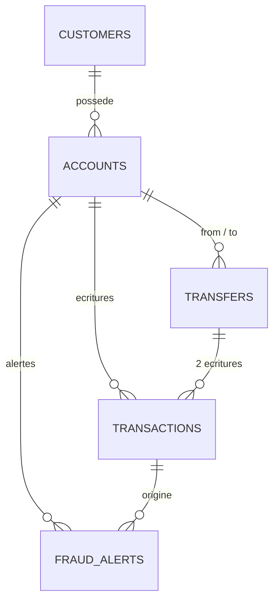

# Projet NovaBank Core

Projet SQL avancé & administration PostgreSQL (Bachelor 2). Base de données d'une banque en ligne, PostgreSQL 18 sur une VM Ubuntu, sans Docker.

## Refaire le projet

```bash
sudo bash scripts/install_postgres.sh   # étape 1 : PostgreSQL, ufw, pg_hba.conf
sudo bash scripts/reset_all.sh          # supprime et recrée tout (demande confirmation + mots de passe)
sudo bash scripts/lancer_tests.sh       # tests (les ERROR sont les interdits refusés)
sudo bash scripts/sauvegarde.sh         # pg_dump + restauration de contrôle
```

Aucun mot de passe dans Git : ils sont demandés au lancement de `reset_all.sh`.
Si le réseau host-only n'est pas `192.168.56.0/24` : `ADMIN_NET=x.x.x.0/24 sudo -E bash scripts/install_postgres.sh`.

## Fichiers

```
sql/    00 rôles+base, 01 tables, 02 données (1 000 000 d'écritures), 03 droits, 04 vues,
        05 index, 06 triggers, 07 procédures, 08 tests, 09-10 bonus
scripts/  install_postgres.sh, reset_all.sh, lancer_tests.sh, sauvegarde.sh, rapport_csv.sh
tests/    test_concurrence.sh
captures/ captures d'écran
```

## Tables



Plus `audit.audit_log` (qui, quand, avant, après en JSON).

- CHECK / UNIQUE : email unique, valide et en minuscules, client majeur, `balance >= 0`, IBAN unique, montant > 0, comptes différents.
- Triggers : solde mis à jour automatiquement, `transactions`/`transfers`/`audit_log` jamais modifiables, un virement = 2 écritures (vérifié au COMMIT), alertes fraude, audit.
- Procédures : `sp_virement` (verrouille les 2 comptes dans l'ordre des id, donc pas de deadlock), `sp_ouvrir_compte`, `sp_releve` (curseur).

## Droits

| Compte | Peut | Ne peut pas |
|---|---|---|
| `analyste1` | lire `v_stats_comptes` et `mv_volume_mensuel` (anonymisées) | lire les tables |
| `support1` | lire `v_clients_support` (masquée), geler/dégeler un compte via `v_comptes_support` | lire `customers`, fermer un compte, toucher au solde |
| `appli1` | exécuter les 3 procédures | accéder aux tables |
| `auditeur1` | lire `audit_log`, `fraud_alerts`, `transactions` | rien modifier |

`bank_owner` possède tous les objets. `pg_hba.conf` : `postgres` en local (peer), propriétaire et appli depuis la VM, les 3 autres profils depuis le réseau host-only, le reste refusé.

## Index

`(account_id, created_at DESC)` pour le relevé, `lower(email)`, index partiel sur les comptes gelés, BRIN sur `created_at`. Mesures avant/après avec `EXPLAIN ANALYZE` dans `sql/05_index.sql`.

## Bonus

C3 (pgcrypto), C4 (injection SQL + correction) dans `sql/09_bonus_cyber.sql` ; D1 (5 requêtes), D2 (score z) dans `sql/10_bonus_data.sql` ; D3 dans `scripts/rapport_csv.sh`.

## Captures

Dans `captures/` : serveur et pare-feu, connexion refusée, `reset_all.sh`, contrôle du million d'écritures, index avant/après, tests, concurrence, sauvegarde, bonus.

